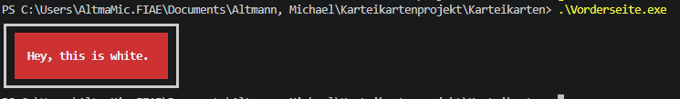
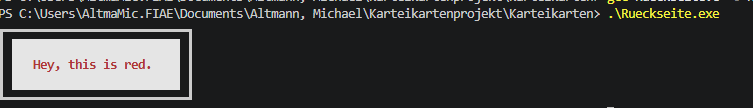

# Michael Altmann – Projektportfolio

Willkommen in meinem Projektportfolio!

Ich bereite mich auf ein Praktikum als **Fachinformatiker für Anwendungsentwicklung** vor und stelle hier meine bisherigen Programmierkenntnisse sowie meine praktischen Erfahrungen vor.

## Programmierkenntnisse

**Programmiersprache:** C

Bisher habe ich mich mit folgenden Themen beschäftigt:

- Variablen und Datentypen
- Bedingungen und Schleifen
- Funktionen und strukturierte Programmierung
- Arrays und Strukturen (`struct`)
- Zeichenkettenverarbeitung
- Dateiverarbeitung mit CSV-Dateien
- Entwicklung konsolenbasierter Anwendungen

## Projekt: Karteikarten-Lernsoftware

**Programmiersprache:** C  
**Betriebssystem:** Windows  
**Projektart:** Gemeinschaftsprojekt mit anderer Person

### Projektbeschreibung

Gemeinsam haben wir eine konsolenbasierte Karteikarten-Lernsoftware entwickelt, mit der Benutzer Vokabeln lernen und ihren Wissensstand überprüfen können.

Die Anwendung verwendet digitale Karteikarten, die innerhalb der Windows-Konsole dargestellt werden.

### Funktionen

- Einlesen von Vokabeln aus CSV-Dateien
- Auswahl vorhandener Karteikartensätze
- Trainingsmodus mit Rückmeldung zu den Antworten
- Anzeige der richtigen Lösung bei falschen Antworten
- Testmodus mit Auswertung der Ergebnisse
- Automatische Anpassung der Karteikartenbreite an die Wortlänge
- Zentrierte Darstellung der Wörter
- Farbige Gestaltung der Karteikarten

### Screenshots

**Vorderseite**

**Rückseite**

### Technische Umsetzung

Die Anwendung wurde in der Programmiersprache C umgesetzt.

Die Vokabeln werden aus CSV-Dateien eingelesen und in Datenstrukturen gespeichert.

Für die Benutzeroberfläche wurden Funktionen entwickelt, die die Breite der Karteikarten anhand der Textlänge berechnen. Dadurch werden auch unterschiedlich lange Wörter mittig dargestellt.

Der Trainingsmodus überprüft die eingegebenen Antworten und zeigt an, ob sie richtig oder falsch sind. Im Testmodus werden die Ergebnisse zusätzlich ausgewertet.

## Weiterentwicklung

Dieses Portfolio wird künftig um weitere Programmierprojekte und neu erworbene Kenntnisse ergänzt.
